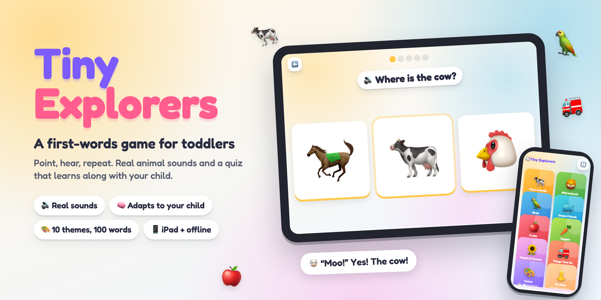

# Tiny Explorers

[](https://akash90gupta.github.io/tiny-explorers/)

**A first-words game for toddlers.** Big pictures, real animal sounds, and a quiz that adapts to one child: "Where is the cow?" Tap it, hear the moo, get confetti.

**▶ Play it: [akash90gupta.github.io/tiny-explorers](https://akash90gupta.github.io/tiny-explorers/)**

> Works on an iPad, a phone, or a laptop. No accounts, no ads, no tracking. Add it to the iPad home screen and it runs full screen, even offline.

---

## Goal

My son is 16 months old. He points at everything and wants to know what it's called. I wanted something we could play together for ten minutes that would:

- **Teach real things:** animals, birds, fruits, veggies, plants, vehicles, colors, and his own body.
- **Use real sounds,** so the cow on screen sounds like the cow at the petting zoo.
- **Notice what he knows,** so we spend time on the words he's still learning, not the ones he already has.
- **Survive a toddler:** fat-finger taps, button mashing, and a palm resting on the screen.

## Problem

Most toddler apps I tried failed in one of three ways.

- **They're slot machines.** Bright, loud, and built to keep a kid tapping. Lots of reward, very little learning.
- **They're flashcards with no memory.** Every session starts from zero. The app has no idea he learned "dog" last week and keeps mixing up "horse" and "cow".
- **They're hard on small hands and short patience.** Tiny targets, menus he can wander into, and "wrong!" buzzers that make him quit.

A 16-month-old can't read, can't follow instructions, and has about a ten-minute window. The app has to do the teaching quietly and keep it fun.

## Approach

Three ideas shaped the whole thing.

**1. Point, hear, repeat.** Every theme has two modes:

| Mode | What happens |
|---|---|
| 👀 **Learn** | Tap any picture to hear its name, its real sound, and a short line ("The cow says moo!"). **Listen** plays through the whole theme. |
| 🎯 **Play** | "Where is the cow?" with 2 to 4 big pictures. Once a sound is half-learned, it sometimes asks by sound alone: "Who says moo?" |

**2. A small learning engine, entirely on the device.** No cloud, no model calls, just a little math that fits a toddler:

- **Knowledge tracing.** Each word keeps a running estimate of how likely he knows it (Bayesian Knowledge Tracing). Only first tries count, and a right answer out of 2 pictures counts less than one out of 4, because guessing is easier.
- **Smart practice.** The next question leans toward words he knows least and words he hasn't seen in a while.
- **Gradual unlocks.** Each theme starts with 3 words. A new one joins when he averages 60% on the current set.
- **Mix-up aware.** If he picks the horse when asked for the cow, those two get paired more often until he can tell them apart.
- **Adaptive difficulty.** 2 pictures while he's learning, then 3, then 4.

**3. Never punish, always guide.** A wrong tap names what he picked ("That's the pig.") and asks again, because naming the wrong one is learning too. After two misses, or if he goes quiet, the right answer gently glows. Every round ends with cheering and at least one star.

## Trade-offs

- **Real recordings over synthesized sounds.** The first version generated every moo and oink in code. It was tiny and needed no files, and it sounded like a 1990s video game. I swapped in 70 real recordings. That adds about 2 MB and a credits file, and it's worth it: a toddler learns the sound of a real cow.
- **Emoji over illustrations.** Emoji are free, crisp at any size, and look great on Apple devices. They look a little different on Windows and Android, and that's a fair price for a zero-asset, open-source app.
- **Simple, explainable ML over a big model.** Knowledge tracing is decades old, fits in about 20 lines, and runs offline. A large model could do more, but it would need a network, a key, and trust I can't verify for a toddler.
- **Hold-to-go-back.** Back buttons need a short hold so he can't accidentally exit mid-game. It's a little slower for me, and it stopped the "where did the game go?" moments.
- **Permissive licenses only.** I skipped some great recordings because they were "personal use only." Everything shipped is public domain, CC0, or Creative Commons with attribution. One clip is non-commercial, and it's flagged.

## Decision / Direction

- **A static web app, not a native app.** Plain HTML, CSS, and JavaScript, with no build step and no framework. It runs in Safari on the iPad, installs to the home screen, works offline, and hosts free on GitHub Pages.
- **Modular themes.** Each theme is one small file listing its items, pictures, sounds, and phrases. Adding an 11th theme means one new file and one line in the registry.
- **Privacy by default.** Progress lives on the device. Nothing is sent anywhere.
- **Next:** pictures from our own photos ("Where is Grandma?"), a bedtime "quiet mode", and more themes as he grows (shapes, numbers, feelings).

## Solution

**10 themes, 100 words:**

| | Theme | Examples |
|---|---|---|
| 🐄 | Farm Animals | cow, pig, sheep, dog, rooster |
| 🦁 | Wild Animals | lion, elephant, monkey, frog, wolf |
| 🦜 | Birds | owl, parrot, penguin, peacock, turkey |
| 🐳 | Ocean Friends | whale, dolphin, seal, crab, octopus |
| 🍎 | Fruits | apple, banana, grapes, watermelon |
| 🥕 | Veggies | carrot, broccoli, corn, potato |
| 🌻 | Plants & Flowers | sunflower, tree, cactus, mushroom |
| 🚒 | Things That Go | fire truck, train, helicopter, rocket |
| 🎨 | Colors | red, blue, yellow, green, purple |
| 👃 | My Body | nose, eyes, hands, feet, teeth |

**Built for toddlers and the grown-ups next to them:**

- **Real sounds** for every animal and vehicle, plus everyday ones: an apple crunch, popcorn popping, a toothbrush, clapping hands. [Credits here.](sounds/CREDITS.md)
- **A spoken voice** asks every question, so no reading is needed.
- **Toddler-proof controls:** huge targets, no pinch-zoom, no long-press menus, and hold-to-go-back.
- **A grown-ups dashboard** (hold 👪): which words he knows, common mix-ups, recent rounds, and settings such as volume, the number of choices, and round length.
- **Self-healing:** if a sound gets stuck, the game moves on by itself. If something does break, a clear **🛟 Fix a problem** button appears. It restarts the audio, keeps his progress, and can copy an error report to share.

## What I learned building it

- **Fake sounds are worse than no sounds.** The synthesized moo was "correct" and still wrong. Real recordings changed the whole feel of the app.
- **Free sound sites hide traps.** Some "download" links serve a 2-second preview, not the full file. Licenses vary clip by clip, and "free" often means "personal use only." I checked every file's license and length.
- **Look at the sound, not just the label.** Rendering a spectrogram of every clip quickly showed which ones were mostly background noise or a quarter-second fragment. Reading the fine print mattered too: my first "snake hiss" was an alligator.
- **iPads pause audio in ways laptops don't.** After a phone call or switching apps, Safari parks the audio engine as "interrupted," and sounds silently stop reporting that they finished. The game froze after a correct answer. Now no step waits forever, and audio wakes up when the app comes back.
- **Toddlers find the bugs adults don't.** A palm resting on the back button while the screen changed sent the game back on its own. A tap faster than the spoken question cut off the celebration. Both were invisible when I tapped politely.
- **Guessing has to be priced in.** With 2 pictures, a coin flip is right half the time. Weighting answers by the number of choices kept the engine from "learning" words he was guessing.
- **Kindness is a design choice.** No buzzers, no red X's. Naming what he picked turned every mistake into another word learned.

---

## Run it locally

No install needed. Any static server works:

```bash
python3 -m http.server 8000
# open http://localhost:8000
```

On an iPad: open the live link in Safari, tap **Share → Add to Home Screen**, and turn the volume up.

## Code

```
index.html              the app shell
css/styles.css          layout, colors, and animations (phone, iPad, laptop)
js/app.js               screens, game flow, input, and the grown-ups dashboard
js/learner.js           the learning engine: knowledge tracing, scheduling, unlocks
js/audio.js             real recordings, speech, the marimba chimes, and hang-proof playback
js/diagnostics.js       the error log behind the Fix button
js/modules/*.js         the 10 themes, one file each
sounds/                 70 trimmed, leveled recordings and their credits
sw.js                   offline support
```

**Add a theme:** copy `js/modules/farm.js`, change the items, add it to `js/modules/index.js`, and drop any new sounds in `sounds/`.

**Debug mode:** add `?debug` to the URL to record which code path caused each screen change in the error report.

## License

Code: MIT. Sounds: each recording keeps its own license, listed in [sounds/CREDITS.md](sounds/CREDITS.md).

---

Built by [Akash Gupta](https://github.com/akash90gupta) for his son · [LinkedIn](https://www.linkedin.com/in/akash90gupta/)
